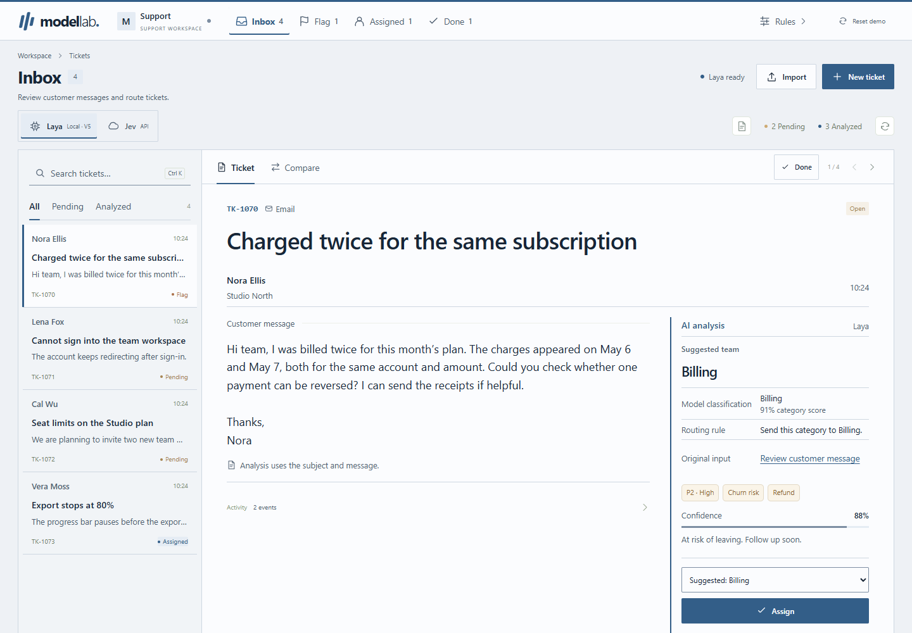
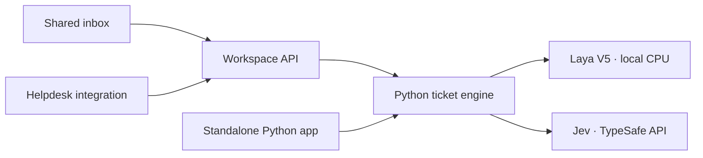

<div align="center">
  
  <h1>Laya × Jev Lab</h1>
  <p><strong>Classify support tickets. Train Laya on your own labelled examples.</strong></p>
  <p><a href="#train-laya"><strong>Train Laya</strong></a> · <a href="#quickstart">Quickstart</a> · <a href="docs/API.md">REST API</a> · <a href="docs/USAGE.zh-CN.md">中文</a></p>
  <p><a href="https://github.com/Mike-Animal-Counseling/laya-jev-lab/actions/workflows/check.yml"></a> · <a href="LICENSE">Apache-2.0</a> · <a href="https://github.com/Mike-Animal-Counseling/laya-jev-lab/releases/tag/v0.1.0">Laya V5 weights</a></p>
</div>

Run **Laya V5** locally on CPU, call **Jev** with your TypeSafe key, or compare both on the same ticket. The engines return a category, priority and complaint, churn and refund signals. Use the Python SDK, connect an existing helpdesk over REST, or run the shared inbox.

## Train Laya

Start the [authenticated workspace](#quickstart) and sign in as its owner. Click **Train Laya** in the workspace header, or [open training on your local instance](http://127.0.0.1:5180/settings?tab=train).

1. **Connect Kaggle once.** Use your own account, API token and GPU quota.
2. **Preview your labelled data.** Start with the in-app CSV template or import an `.xlsx` file. Review category coverage, remove sensitive information and confirm the upload.
3. **Click Train.** The app submits a private GPU job to your Kaggle account and retrieves the result. No notebook editing or manual file transfer is required.

The job adapts Laya V5's decision layers. Review the held-out comparison before activating the candidate. You can download the adapter for SDK use or restore V5 at any time. Local CPU adaptation has been tested with synthetic data. Live Kaggle GPU acceptance is still pending. See the [training guide](docs/TRAINING.md) for data requirements and the local training option.

## Quickstart

Clone the repository and put [`laya-v5-inference.zip`](https://github.com/Mike-Animal-Counseling/laya-jev-lab/releases/download/v0.1.0/laya-v5-inference.zip) in the checkout's `downloads/` directory.

```sh
docker compose build
docker compose run --rm api python -m service.manage init --workspace demo --owner admin
docker compose --profile setup run --rm model-install
docker compose up -d --wait
```

Open the [inbox](http://127.0.0.1:5180/laya-ft) and sign in as `admin` in workspace `demo` using the password you set during initialization. V5 is ready for inference after verified import. See [deployment](docs/DEPLOYMENT.md) for host requirements, HTTPS and backups, or [local evaluation](docs/DEPLOYMENT.md#local-evaluation) for a single-user demo with synthetic tickets.

## What you can do

| Workflow | Entry point |
| --- | --- |
| Classify locally in a Python app | [Laya SDK](INTEGRATION.md). Install from source, then load the verified V5 checkpoint. |
| Call Jev or compare the two engines | [Jev SDK and comparison](INTEGRATION.md). Jev sends the selected ticket text to TypeSafe. |
| Classify from your helpdesk | [REST API](docs/API.md). Use a scoped workspace key with `POST /v1/classify`. |
| Triage in a shared inbox | [Inbox and intake](INTAKE.md). Import from CSV, Excel, email or Zendesk, then review and assign tickets. |



## Architecture



Training is a separate owner workflow. It transfers the reviewed text and labels to the owner's private Kaggle dataset after confirmation. Ticket import and scheduled sync do not invoke either model.

## Documentation

- [Model card](MODEL_CARD.md) and [supported scope](SCOPE.md)
- [Privacy](PRIVACY.md), [security](SECURITY.md) and [production security](docs/PRODUCTION_SECURITY.md)
- [Contributing](CONTRIBUTING.md) and [upstream notices](NOTICE.md)

Code is [Apache-2.0](LICENSE). Review the model card and notices for model asset terms.
