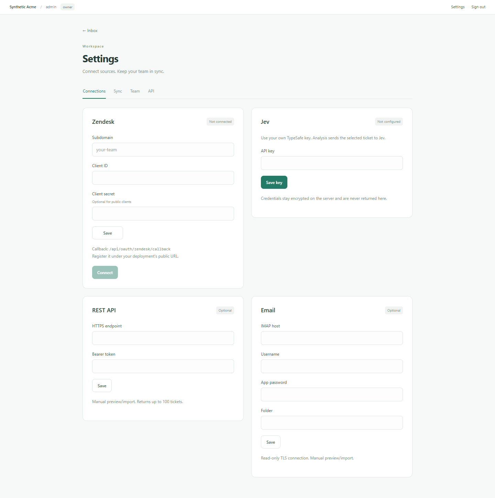

# Laya × Jev · Ticket Classification

[](https://github.com/Mike-Animal-Counseling/laya-jev-lab/actions/workflows/check.yml) · [Apache-2.0](LICENSE) · [Model download](https://github.com/Mike-Animal-Counseling/laya-jev-lab/releases/tag/v0.1.0)

**Drop structured SaaS ticket classification into your helpdesk. Run trained Laya V5 locally, call Jev, or compare both under one rubric.**

Use the Python SDK without a UI, connect any helpdesk to the REST API, or run an optional inbox with authenticated workspaces. Your helpdesk keeps customer conversations and business actions.


## Choose your integration

| Use case | Entry point | Requirements |
| --- | --- | --- |
| Local Laya in a Python app | `LayaEngine` | Python 3.12, CPU runtime, reviewed V5 weights |
| Jev in a Python app | `JevEngine` | Python 3.12, your TypeSafe key; no Torch |
| Any existing helpdesk | REST `/v1/classify` | Self-hosted service, scoped integration key |
| A shared team inbox | Docker Compose | Operator-created workspace; HTTPS remotely |
| Single-user evaluation | Local demo | Python 3.12, Node.js 22.13+ |

The SDK is a separate Python package built from this repository. It has no frontend, database or credential discovery, and is not currently published to PyPI.

## Independent engines

Install from a checkout:

```sh
python -m pip install .
```

Jev needs only the base package:

```python
from ticket_engine import JevEngine

# Retrieve this from your application's secret store.
engine = JevEngine(api_key=your_api_key)
result = engine.classify("Please explain the team plan.", subject="Pricing")
print(result.to_dict())
```

For Laya, download [laya-v5-inference.zip](https://github.com/Mike-Animal-Counseling/laya-jev-lab/releases/download/v0.1.0/laya-v5-inference.zip) to `downloads/`, then:

```sh
python -m pip install torch==2.14.0 --index-url https://download.pytorch.org/whl/cpu
python -m pip install ".[laya]"
python projects/laya_ft/import_checkpoint.py downloads/laya-v5-inference.zip
```

The unchanged v0.1.0 V5 archive is compatible with v0.2.0: inference hashes and required notices remain identical. Import verifies every declared file. No training is needed.

```python
from ticket_engine import LayaEngine

engine = LayaEngine(model_path="models/ticket-finetuned-v5")
result = engine.classify("We were charged twice. Please refund the extra payment.",
                         subject="Duplicate charge")
print(result.category, result.priority, result.needs_review)
```

Reuse one instance per process. `engine.prepare()` verifies and loads Laya before traffic. Missing or changed weights fail explicitly. Local inference never calls Jev as a fallback. See [INTEGRATION.md](INTEGRATION.md) for output fields, comparison, command-line JSON and errors.

## Connect an existing helpdesk

Deploy the service and create a key in **Settings → API**:

```python
from uuid import uuid4
from ticket_engine import ServiceClient

client = ServiceClient("https://tickets.example.com", api_key=integration_key)
response = client.classify("Please refund the duplicate payment.",
                           subject="Billing", engine="laya", request_id=str(uuid4()))
print(response["result"])
```

`POST /v1/classify` returns classification without creating an inbox ticket. `POST /v1/tickets` imports/upserts source tickets; analysis is a separate explicit action. UUID idempotency keys protect identical retries. Keys belong to one workspace, with limited scopes and expiry. Read the [REST guide](docs/API.md), [OpenAPI contract](service/openapi.py) and [adapter example](examples/helpdesk_adapter.py).

## Shared inbox

Download the model ZIP to `downloads/` first, then:

```sh
docker compose build
docker compose run --rm api python -m service.manage init --workspace demo --owner admin
docker compose --profile setup run --rm model-install
docker compose up -d --wait
```

Initialization prompts for your own password; no default account or creator credential is supplied. Open **http://127.0.0.1:5180/laya-ft** and sign in. New workspaces start empty. Owners invite members/viewers in **Settings → Team**.

Settings configures Jev, a Zendesk OAuth client and optional REST/IMAP sources. Zendesk supports PKCE, encrypted expiring tokens, refresh rotation, pausable incremental sync and source updates. The operator must register their own client/callback; no shared provider app is bundled.



See [DEPLOYMENT.md](docs/DEPLOYMENT.md) for HTTPS, multiple workspaces, backups and upgrades. The supported topology is one service replica with SQLite for small teams. Remote hosting requires a secured HTTPS edge.

## Local evaluation

Activate a Python 3.12 virtual environment, install the CPU Torch build above, then:

```sh
python -m pip install --require-hashes -r requirements.lock
npm ci
python projects/laya_ft/import_checkpoint.py downloads/laya-v5-inference.zip
npm run build
python scripts/start.py
```

Open **http://127.0.0.1:5180/laya-ft**. The loopback-only demo starts with eight synthetic tickets. Optional connections use this repository's private `.env.local`; start from the blank `.env.example`. Use the authenticated service for shared deployment.

## Capabilities and boundaries

- **Billing, Technical, Sales, Accounts, General**, plus priority, complaint, churn and refund signals.
- English **Inbox, Flag, Assigned, Done**, review, comparison and export.
- **Excel, CSV, email files, REST, IMAP and Zendesk** intake with validation and duplicate checks. [Intake guide](INTAKE.md).
- Workspace roles, scoped keys, revision checks and explicit model calls. Imports and scheduled sync never invoke AI.
- Laya stays local. Explicit Jev analysis sends subject/body to TypeSafe; provider pricing applies. Opening comparison only reads saved results.

Confidence is not measured accuracy. Evaluate representative, independently labelled tickets before automating routing. The project does not send replies, modify Zendesk tickets or expose customer submission forms. See [SCOPE.md](SCOPE.md) and [MODEL_CARD.md](MODEL_CARD.md).

Source and inference assets exclude customer databases, raw training examples, credentials and original workspace history. Runtime tickets live in private `var/` storage; exports and backups can contain personal data. Shared-service connection secrets are encrypted; the local demo uses a private configuration file. See [PRIVACY.md](PRIVACY.md), [SECURITY.md](SECURITY.md) and [deployment security](docs/PRODUCTION_SECURITY.md).

[Contributions](CONTRIBUTING.md) should use synthetic tickets and preserve explicit external calls and workspace isolation. Code is Apache-2.0; upstream attribution remains in [NOTICE.md](NOTICE.md). This is an independent project without provider endorsement.
