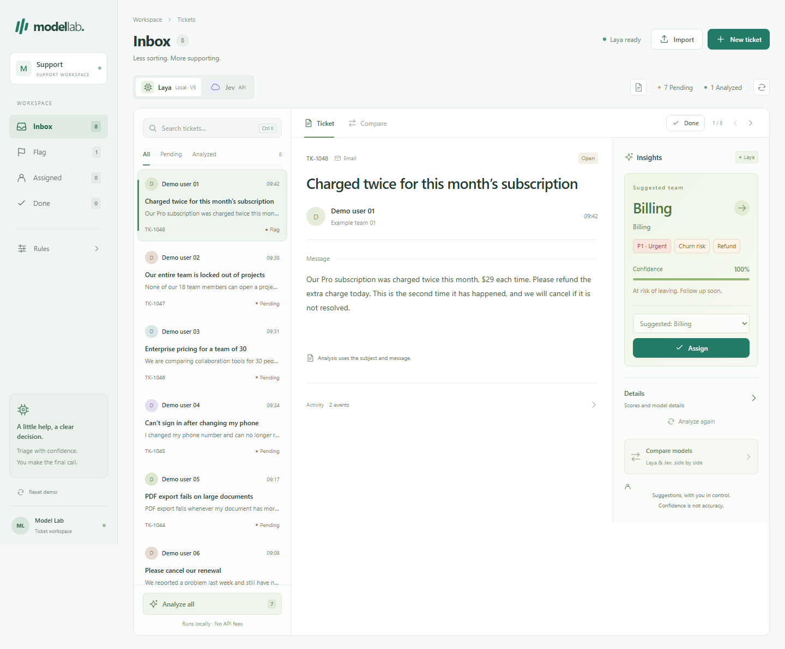

# Laya × Jev · SaaS Ticket Classification

[](https://github.com/Mike-Animal-Counseling/laya-jev-lab/actions/workflows/check.yml) · [Apache-2.0](LICENSE) · [Download](https://github.com/Mike-Animal-Counseling/laya-jev-lab/releases/tag/v0.1.0)

**Compare fine-tuned Laya V5 and Jev on the same support tickets, using the same classification rules.**

This project provides a Python ticket-classification SDK and a local inbox for inspecting both models' decisions. Use it to explore SaaS support triage, compare local inference with a hosted API, and integrate structured classification into an existing workflow.



## What it does

- Classifies tickets into **Billing, Technical, Sales, Accounts or General**.
- Adds **priority, complaint, churn risk and refund** signals, with confidence and review reasons.
- Compares saved Laya/Jev results side by side, including disagreements, latency and available token usage.
- Provides a concise English inbox with **Flag, Assigned and Done**, manual review, batch analysis and export.
- Imports **Excel, CSV and email files**, with validation, preview, duplicate checks and atomic saves.
- Includes read-only **Zendesk, REST API and IMAP** adapters ready for operator-supplied configuration.

The intended users are developers evaluating ticket-routing models and support teams exploring classification on their own representative tickets. Category definitions and integration boundaries are documented in [SCOPE.md](SCOPE.md).

## Two engines, one rubric

| | Fine-tuned Laya V5 | Jev |
| --- | --- | --- |
| Execution | Local CPU, offline inference | TypeSafe API over HTTPS |
| Setup | Install the reviewed V5 weights | Supply your own API key |
| Ticket data | Stays in the local process/workspace | Sent to TypeSafe when you explicitly analyze |
| Cost | No inference API charge | Provider pricing applies |
| Role | Task-specific local classifier | Hosted comparison engine |

Both receive the same subject, message and five classification questions. Results, assignments and revisions stay separate per engine. Opening the comparison view does not invoke a model.

**Confidence is not measured accuracy.** The examples are synthetic; the UI is not an independent benchmark. Review the [model card](MODEL_CARD.md) and evaluate representative, independently labelled tickets before automating routing.

## Quick start: local inbox

Requires **Python 3.12** and **Node.js 22.13+**. The quick start below uses local CPU inference.

```sh
git clone https://github.com/Mike-Animal-Counseling/laya-jev-lab.git
cd laya-jev-lab
git checkout v0.1.0
python -m venv .venv
```

Activate the environment with `.venv\Scripts\Activate.ps1` in Windows PowerShell, or `source .venv/bin/activate` on macOS/Linux. Other platforms need a compatible PyTorch build.

```sh
python -m pip install torch==2.14.0 --index-url https://download.pytorch.org/whl/cpu
python -m pip install -r requirements.txt
npm ci
```

Download [laya-v5-inference.zip](https://github.com/Mike-Animal-Counseling/laya-jev-lab/releases/download/v0.1.0/laya-v5-inference.zip) into this directory. [SHA256SUMS.txt](https://github.com/Mike-Animal-Counseling/laya-jev-lab/releases/download/v0.1.0/SHA256SUMS.txt) provides the archive checksum. Use the source and weights from the same release; the importer verifies every required file against the pinned V5 manifest and checks its notices.

```sh
python projects/laya_ft/import_checkpoint.py laya-v5-inference.zip
npm run build
python scripts/start.py
```

Open **http://127.0.0.1:5180/laya-ft**. The app starts with eight synthetic tickets. First model loading takes longer than subsequent analyses; missing weights produce an explicit unconfigured state. Press Ctrl+C to stop both services.

### Optional: enable Jev or source connections

Copy `.env.example` to this repository's `.env.local`. Set your own `TYPESAFE_API_KEY` to enable Jev. No key is needed for local Laya inference. The app reads credentials only from its own configuration file and never returns them to the browser.

For Zendesk, generic API or mailbox intake, follow [INTAKE.md](INTAKE.md). Click **Sync** to preview source tickets, then confirm **Import** to save them. The current adapters support bounded, manual pulls; pagination, scheduled synchronization, source updates and provider OAuth onboarding are future extensions.

## Use the Python SDK

The SDK can be installed independently of the inbox, Node.js and demo database:

```sh
python -m pip install .
```

Local inference additionally needs `.[local]` and the reviewed model files. Then:

```python
from ticket_engine import TicketEngine

engine = TicketEngine("laya", model_path="models/ticket-finetuned-v5")
result = engine.classify(
    "Our subscription was charged twice. Please refund the extra payment.",
    subject="Duplicate charge",
)
print(result.to_dict())
```

The SDK returns structured results and does not persist tickets or discover credentials. See [INTEGRATION.md](INTEGRATION.md) for local/Jev examples, comparison, output fields and error handling (Chinese guide).

## Data and runtime boundaries

The inbox is a **loopback-only, single-user workspace**. It does not provide public hosting, customer submission forms or multi-tenant authentication. Assignments stay in the local workspace; connectors do not send replies or modify external tickets.

Ticket contents, results and history persist in `var/`; credentials stay in `.env.local`. Both are excluded from source publication. Preview uploads are parsed in memory and not retained as files. The SDK itself has no ticket store. Exports can contain personal information supplied by an operator.

The source and inference archive include no original customer database, raw training examples, notebooks, credentials or inherited workspace history. Known-secret scanning is a useful check, not a proof that every possible privacy issue has been excluded. Details: [PRIVACY.md](PRIVACY.md) · [SECURITY.md](SECURITY.md).

## Contributing and license

[CONTRIBUTING.md](CONTRIBUTING.md) covers development checks and reviewed source exports. Reports and contributions should use synthetic tickets. Security issues can be submitted through [private vulnerability reporting](https://github.com/Mike-Animal-Counseling/laya-jev-lab/security/advisories/new).

Project code is licensed under **Apache-2.0**. Upstream Laya and the multilingual encoder retain their own licenses and attribution; see [NOTICE.md](NOTICE.md), [LICENSE](LICENSE) and the [model card](MODEL_CARD.md). This is an independent project with no claim of endorsement by either model provider.

## Security and deployment

Read the [security policy](SECURITY.md) and [production requirements](docs/PRODUCTION_SECURITY.md) before deployment.
